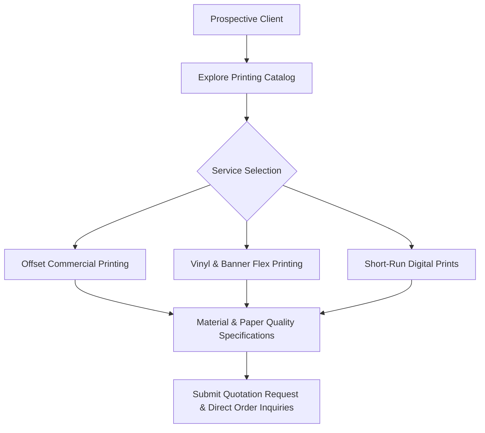

# Printing Press Commercial Website

<div align="center">

[](https://developer.mozilla.org)
[](https://developer.mozilla.org)
[](https://developer.mozilla.org)
[](LICENSE)

</div>

A commercial web platform for an offset and digital printing press. Showcases commercial publishing services including business stationery, brochures, vinyl banners, and custom flex printing.

---

## Service Flow



---

## Features

- **Commercial Printing Catalog**: Detailed overviews of visiting cards, brochures, banners, and wedding invitation printing.
- **Visual Portfolio Gallery**: High-resolution showcase of past printing and finishing samples.
- **Responsive Web Interface**: Optimized across mobile phones, tablets, and desktop workstations.
- **Fast Performance**: Pure vanilla web technology stack without heavy frontend dependencies.

---

## Getting Started

1. Clone the repository:
   ```bash
   git clone https://github.com/Midhun-M-git/press-website.git
   cd press-website
   ```

2. Open in browser:
   ```bash
   open index.html
   ```

---

## License

This project is licensed under the GNU General Public License v3.0. See the [LICENSE](LICENSE) file for details.
